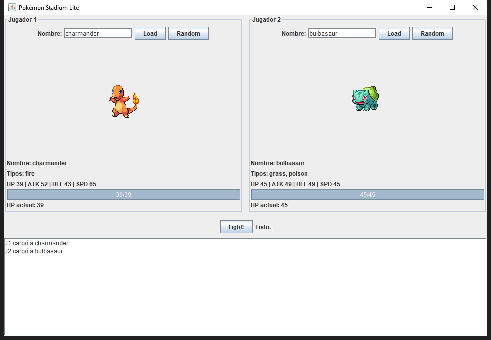
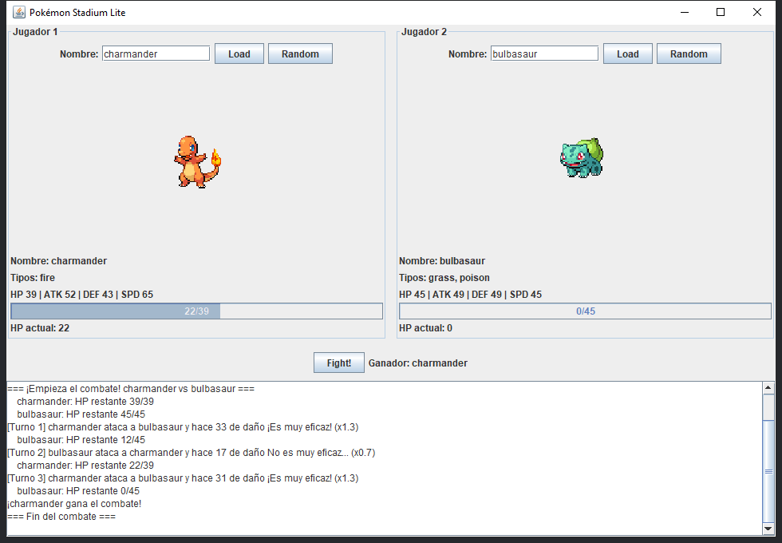
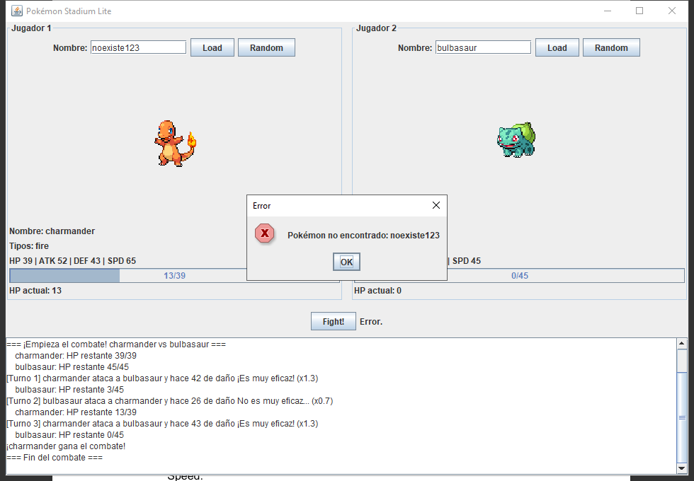

# Pokémon Stadium Lite

Mini-aplicación de escritorio en **Java Swing** que simula un combate por turnos estilo Pokémon Stadium entre dos Pokémon obtenidos en vivo desde [PokeAPI](https://pokeapi.co/).

- **Programa:** Ingenieria en Sistemas
- **Materia:** Desarrollo de Software III
- **Docente:** Mg(c). Juan Pablo Pinillos Reina

## Integrantes

- Javier Andrés Muñoz Tavera 2380421
- Juan David Turriago Orozco 2477182

## Funcionalidades

- Selección de Pokémon para 2 jugadores: por nombre (campo de texto + **Load** o Enter) o aleatorio (**Random**).
- Vista de cada Pokémon: sprite frontal, nombre, tipos, stats (HP, Attack, Defense, Speed) y barra de HP actual.
- Combate por turnos con **Fight!** (deshabilitado hasta que ambos Pokémon estén cargados).
- Log de batalla desplazable: turno, atacante, defensor, daño, crítico, efectividad y HP restante.
- Errores visibles sin congelar la interfaz ("Pokémon no encontrado", "Error de red", etc.).

## Requisitos

- Java 11 o superior (JDK).
- Conexión a internet.
- Librería `org.json` incluida en `lib/json-20230227.jar` (no hay que descargar nada).

## Ejecución

### Opción 1: IntelliJ IDEA

1. `File > Open...` y seleccionar la carpeta del proyecto (contiene `DS352.iml`, que ya referencia `lib/json-20230227.jar`).
2. Configurar un JDK 11+ en `File > Project Structure > Project`.
3. Ejecutar `src/stadium/PokemonStadiumLiteApp.java` (método `main`).

### Opción 2: Línea de comandos (Windows / PowerShell)

Desde la carpeta raíz del proyecto:

```powershell
javac -encoding UTF-8 -d out -cp "lib\json-20230227.jar" src\stadium\*.java
java -cp "out;lib\json-20230227.jar" stadium.PokemonStadiumLiteApp
```

En Linux/macOS se usa `:` en lugar de `;` en el classpath y `/` en las rutas.

## Estructura

```
src/stadium/
├── Pokemon.java                 # Modelo: stats base, tipos, sprite y HP actual
├── PokeApiClient.java           # HttpClient + parseo JSON (org.json)
├── Battle.java                  # Reglas del combate (turnos, daño, crítico, efectividad)
├── BattleListener.java          # Eventos del combate: onTurn, onHpChanged, onBattleEnded
└── PokemonStadiumLiteApp.java   # Interfaz Swing (JFrame) que implementa BattleListener
```

## Diseño

La solución separa responsabilidades en el paquete `stadium`. `Pokemon` es el modelo (stats, tipos, sprite y HP actual, que nunca baja de 0). `PokeApiClient` consulta `https://pokeapi.co/api/v2/pokemon/{name}` con `java.net.http.HttpClient`, parsea el JSON con `org.json` y traduce los fallos a mensajes claros (404 → "Pokémon no encontrado", fallos de conexión → "Error de red"). `Battle` contiene solo las reglas del combate y no conoce Swing: informa todo lo que ocurre mediante la interfaz propia `BattleListener` (`onTurn`, `onHpChanged`, `onBattleEnded`). Así la lógica queda desacoplada de la UI y se podría probar o reutilizar con otra interfaz.

`PokemonStadiumLiteApp` construye la ventana, registra los `ActionListener` de los botones **Load**, **Random** y **Fight!** e implementa `BattleListener`. La UI del combate se actualiza solo a partir de esos eventos. Las peticiones HTTP, la descarga de sprites y el combate (que hace pausas entre turnos) se ejecutan en `SwingWorker`, fuera del Event Dispatch Thread. Los eventos del combate vuelven al EDT con `SwingUtilities.invokeLater`, de modo que la interfaz nunca se congela. Mientras hay una carga o un combate en curso, los botones que podrían generar estados inconsistentes quedan deshabilitados.

## Reglas del combate

- **Orden de turnos:** inicia el de mayor Speed; si empatan, el inicio es aleatorio. Después se alternan.
- **Fórmula de daño elegida:**

  ```
  base = max(1, ATK × rand(0.85 – 1.15) − DEF × rand(0.35 – 0.60))
  daño = max(1, round(base × crítico × efectividad))
  ```

  Es una variante de la sugerida (`ATK × random(0-1) − DEF × random(0-1)`). Con factores entre 0 y 1 el daño sale muy a menudo en 0 o negativo y el combate se estanca. Acotando los rangos, el ataque pesa más que la defensa, hay variación entre turnos y el daño mínimo es 1.
- **Crítico:** 10 % de probabilidad, multiplicador ×1.5.
- **Efectividad simple (solo primer tipo):** Agua > Fuego, Fuego > Planta, Planta > Agua → ×1.3; la inversa → ×0.7; el resto → ×1.0.
- **HP** nunca es negativo; el combate termina cuando un HP llega a 0 y se anuncia el ganador.
- Si ambos jugadores eligen el mismo Pokémon, se identifican como `nombre (J1)` y `nombre (J2)`.

## Capturas de pantalla

**Selección de Pokémon**



**Combate terminado** (con efectividad de tipos y HP restante en el log)



**Manejo de errores** (Pokémon inexistente)


